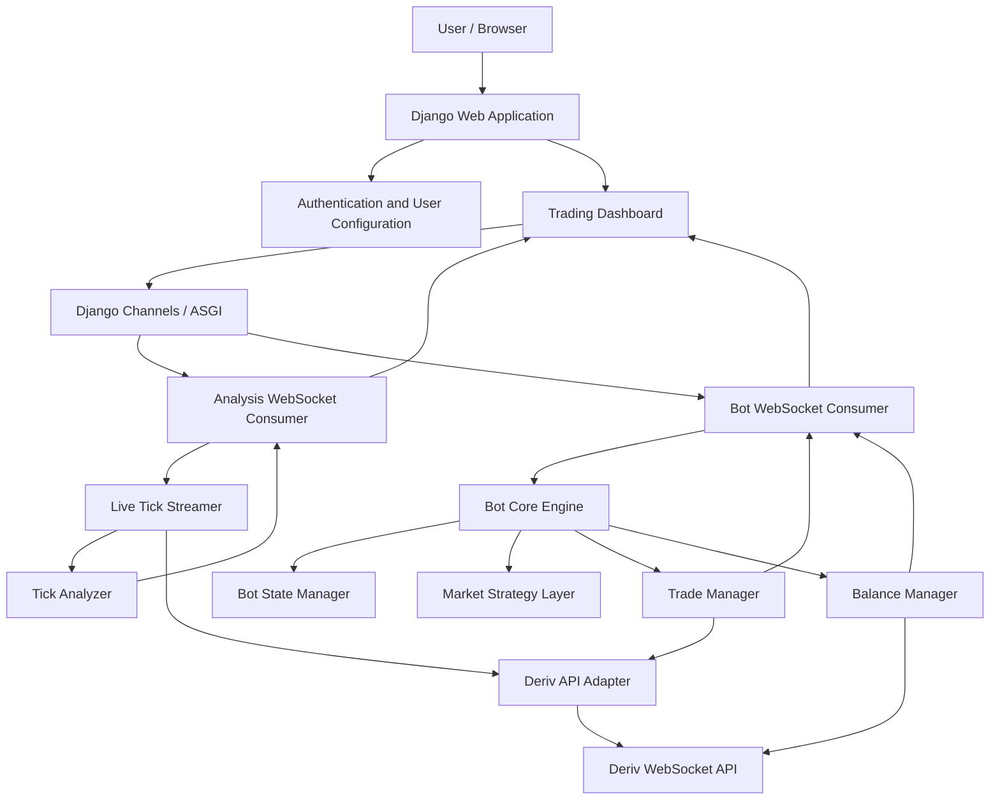

# PROJECT ZER0
## Asynchronous Trading Automation & Real-Time Market Intelligence Platform

---

## 1. PROJECT OVERVIEW

Project Zer0 is a Python-based automated trading platform built with Django, Django Channels and asynchronous WebSocket communication. It integrates with the Deriv WebSocket API to retrieve live synthetic-index market data, analyse incoming price ticks, evaluate configurable trading conditions, execute contracts and monitor account balances in real time.

The platform combines a web-based trading dashboard with an asynchronous backend execution engine. It provides configurable trading strategies, account-specific settings, automated contract management, stake progression, balance monitoring and live execution updates.

The system is designed around event-driven processing, persistent WebSocket connections and modular trading components, allowing market-data ingestion, strategy evaluation and contract execution to operate through coordinated asynchronous tasks.

### Core Capabilities

- Real-time market-data streaming through WebSockets.
- Automated Deriv contract execution.
- Asynchronous Python trading engine.
- Configurable market strategies.
- Live tick analysis and digit-frequency calculations.
- Even/Odd, Over/Under, Matches/Differs and Rise/Fall contract support.
- Automated stake progression and recovery configuration.
- Account balance monitoring.
- Configurable stop-loss and take-profit thresholds.
- User-specific trading configurations.
- Live trading dashboard and execution monitoring.
- Persistent WebSocket communication between frontend and backend.

---

## 2. TECHNOLOGY STACK

| Technology | Purpose |
|---|---|
| Python | Core application and trading logic |
| Django 5.2 | Backend framework and application infrastructure |
| Django Channels | Asynchronous WebSocket communication |
| Daphne | ASGI server |
| Python WebSockets | External API communication |
| Deriv WebSocket API | Market data and contract execution |
| SQLite | Relational database |
| HTML5 | Frontend structure |
| CSS3 | Interface styling |
| JavaScript | Frontend interaction and real-time updates |
| Bootstrap 5 | Responsive UI components |
| Tailwind CSS | Utility-based styling |
| Chart.js | Market-data visualization |
| Django ORM | Database abstraction and persistence |
| asyncio | Asynchronous execution and task coordination |

---

## 3. SYSTEM ARCHITECTURE

Project Zer0 follows a modular application architecture that separates the presentation layer, application services, real-time communication, market analysis and trading execution.

### High-Level Architecture



### Architectural Components

#### 3.1 Presentation Layer

The presentation layer provides the browser-based interface for interacting with the trading application.

It includes:

- User registration and authentication.
- Account configuration.
- Deriv API token configuration.
- Market and instrument selection.
- Trading strategy configuration.
- Live balance display.
- Bot start and stop controls.
- Real-time market analysis.
- Digit-frequency visualization.
- Trading activity monitoring.
- Session performance statistics.

The frontend communicates with the backend through Django HTTP views and WebSocket connections.

#### 3.2 Application Layer

Django provides the core application infrastructure.

Its responsibilities include:

- User authentication and session management.
- Database models and relationships.
- Form validation.
- User-specific configuration.
- Dashboard rendering.
- HTTP request handling.
- Application routing.
- Administrative interfaces.

#### 3.3 Real-Time Communication Layer

Django Channels extends the application with asynchronous WebSocket communication.

The ASGI application uses:

- `ProtocolTypeRouter` for HTTP and WebSocket protocol routing.
- `AuthMiddlewareStack` for authenticated WebSocket sessions.
- `URLRouter` for WebSocket endpoint resolution.
- Asynchronous consumers for real-time communication.

The primary WebSocket endpoints are:

```text
/wss/analysis/
/wss/bot/
```

#### 3.4 Trading Execution Layer

The execution layer coordinates the trading lifecycle:

1. Retrieve user-specific API credentials.
2. Establish external API communication.
3. Subscribe to market data.
4. Process incoming market ticks.
5. Evaluate trading conditions.
6. Generate contract proposals.
7. Purchase contracts.
8. Track pending contracts.
9. Evaluate contract outcomes.
10. Update trading state.
11. Monitor account balances.
12. Broadcast execution updates.

The main orchestration logic is implemented in `bot_logic/bot_core.py`.

---

## 4. DERIV API INTEGRATION

Project Zer0 integrates with the Deriv WebSocket API for real-time market communication and automated contract execution.

### API Endpoint

```text
wss://ws.binaryws.com/websockets/v3?app_id=84524
```

The application uses individual user API tokens for account authorization and trading operations.

### 4.1 Connection Lifecycle

The external API communication process follows this sequence:

1. Establish an asynchronous WebSocket connection.
2. Submit an authorization request.
3. Validate the authorization response.
4. Subscribe to the required market or account information.
5. Process incoming JSON messages.
6. Handle API responses and errors.
7. Close the connection when the corresponding task terminates.

The API communication utility is located at:

```text
utils/deriv_api.py
```

Trade-specific API communication is also implemented through:

```text
bot_logic/trade_manager.py
```

### 4.2 Supported API Operations

The integration supports operations associated with:

- Account authorization.
- Market tick subscriptions.
- Balance subscriptions.
- Contract proposal requests.
- Contract purchases.
- Open contract monitoring.
- Contract result retrieval.
- Contract cancellation.

### 4.3 Market Data Processing

Market data is received through the Deriv tick subscription interface.

Each incoming observation contains market information such as:

- Symbol.
- Quote.
- Epoch timestamp.
- Last digit.

The application normalizes incoming quotes and extracts their final decimal digit according to the configured precision of the selected instrument.

Conceptually:

```python
multiplier = 10 ** decimal_places
last_digit = int(round(quote * multiplier)) % 10
```

### 4.4 Market Precision

| Market | Decimal Places |
|---|---:|
| Volatility 10 | 3 |
| Volatility 25 | 3 |
| Volatility 50 | 4 |
| Volatility 75 | 4 |
| Volatility 100 | 2 |
| Volatility 10 (1s) | 2 |
| Volatility 25 (1s) | 2 |
| Volatility 50 (1s) | 2 |
| Volatility 75 (1s) | 2 |
| Volatility 100 (1s) | 2 |

---

## 5. SUPPORTED MARKET INSTRUMENTS

The application is configured to work with Deriv synthetic volatility indices.

| Symbol | Instrument |
|---|---|
| `R_10` | Volatility 10 Index |
| `R_25` | Volatility 25 Index |
| `R_50` | Volatility 50 Index |
| `R_75` | Volatility 75 Index |
| `R_100` | Volatility 100 Index |
| `1HZ10V` | Volatility 10 (1s) Index |
| `1HZ25V` | Volatility 25 (1s) Index |
| `1HZ50V` | Volatility 50 (1s) Index |
| `1HZ75V` | Volatility 75 (1s) Index |
| `1HZ100V` | Volatility 100 (1s) Index |

Market symbol definitions are maintained in:

```text
user_config/models.py
```

---

## 6. REAL-TIME MARKET ANALYSIS ENGINE

The analysis subsystem processes continuous market tick updates and calculates statistical information from recent observations.

Its primary components are:

```text
analysis/
├── consumers.py
├── routing.py
├── tick_streamer.py
├── tick_analyzer.py
└── utils.py
```

### 6.1 LiveTickStreamer

`LiveTickStreamer` manages the market-data streaming process for an authenticated user.

Its responsibilities include:

- Retrieving the user's Deriv API token.
- Selecting the market symbol.
- Initializing the tick analyzer.
- Starting asynchronous tick-processing tasks.
- Receiving market updates.
- Maintaining recent tick history.
- Calculating digit-frequency statistics.
- Broadcasting analysis updates.
- Managing the lifecycle of the streaming task.

The streamer uses bounded `deque` collections to retain recent observations.

These collections maintain:

- Recent last digits.
- Corresponding tick timestamps.

### 6.2 TickAnalyzer

The `TickAnalyzer` class processes the recent tick history and calculates statistical information.

#### Digit Frequency Analysis

The analyzer counts occurrences of digits from 0 through 9 within the observation window.

It ranks the five most frequently occurring digits and provides:

- Rank.
- Digit.
- Occurrence count.
- Percentage of total observations.

The frequency calculation is:

\[
P(d)=\frac{N_d}{N}\times100
\]

Where:

- \(P(d)\) represents the observed frequency percentage.
- \(N_d\) represents the number of occurrences of digit \(d\).
- \(N\) represents the total number of observations.

#### Even/Odd Distribution

The analyzer classifies digits into two categories.

Even digits:

```text
0, 2, 4, 6, 8
```

Odd digits:

```text
1, 3, 5, 7, 9
```

It calculates their respective occurrence counts within the selected observation window.

#### Tick Timing Analysis

The system retains tick timestamps and calculates the average time difference between consecutive observations.

\[
\Delta t_{avg} =
\frac{\sum_{i=1}^{n-1}(t_i-t_{i-1})}{n-1}
\]

This provides a representation of observed tick arrival intervals.

#### Dominance-Based Timer

The analyzer calculates a suggested timer based on the dominant digit's observed frequency.

| Dominant Digit Frequency | Suggested Timer |
|---|---:|
| 40% or higher | 15 seconds |
| 30% to below 40% | 10 seconds |
| Below 30% | 5 seconds |

### 6.3 Analysis Update Structure

The analysis subsystem sends structured JSON updates to the frontend.

Example:

```json
{
  "type": "analysis_update",
  "tick": {},
  "last_digit": 6,
  "history_size": 50,
  "top_5_last_digits": [],
  "recommended_timer": "00:00:05",
  "average_time_diff": "00:00:01",
  "volatility_value": 50,
  "digit_counts": {
    "even": 25,
    "odd": 25,
    "frequency": {}
  }
}
```

These updates allow the dashboard to refresh its market analysis panels and visualizations as new ticks arrive.

---

## 7. TRADING STRATEGY ENGINE

Trading strategies are implemented as independent modules under:

```text
bot_logic/markets/
```

The strategy architecture separates contract-specific prediction generation and outcome evaluation from the main execution engine.

### 7.1 Base Market Strategy

File:

```text
bot_logic/markets/base_market.py
```

The abstract `MarketStrategy` class defines the common interface for strategy implementations.

Principal methods:

```python
get_prediction_string()
evaluate_result()
```

`get_prediction_string()` generates the contract representation used by the execution layer.

`evaluate_result()` evaluates the supplied market outcome against the configured strategy.

### 7.2 Even/Odd Strategy

File:

```text
bot_logic/markets/even_odd.py
```

The Even/Odd strategy evaluates the parity of the relevant final digit.

Supported contract types:

```text
DIGITEVEN
DIGITODD
```

The parity conditions are:

```python
last_digit % 2 == 0
```

and:

```python
last_digit % 2 == 1
```

The strategy also supports configured recovery prediction values.

### 7.3 Over/Under Strategy

File:

```text
bot_logic/markets/over_under.py
```

This strategy evaluates the last digit against a configured threshold.

Supported contract types:

```text
DIGITOVER
DIGITUNDER
```

Comparison conditions:

```python
last_digit > threshold
```

```python
last_digit < threshold
```

The implementation supports a separate recovery threshold.

### 7.4 Matches/Differs Strategy

File:

```text
bot_logic/markets/matches_differs.py
```

This strategy evaluates whether the resulting last digit matches a configured target digit.

Supported contract types:

```text
DIGITMATCH
DIGITDIFF
```

Its configuration includes:

- Target digit.
- Recovery target digit.
- Exact-match evaluation.
- Differing-digit evaluation.

### 7.5 Rise/Fall Strategy

File:

```text
bot_logic/markets/rise_fall.py
```

The Rise/Fall strategy evaluates the direction of price movement.

The price difference is calculated as:

\[
\Delta P=P_t-P_{t-1}
\]

For a Rise prediction:

\[
\Delta P>0
\]

For a Fall prediction:

\[
\Delta P<0
\]

The strategy generates the appropriate contract direction and evaluates the corresponding price movement.

### 7.6 Strategy Selection

The main bot engine selects the strategy using the user's configured market type.

The configuration includes:

- Market type.
- Prediction direction or parity.
- Target threshold.
- Recovery threshold.
- Selected instrument.

This allows the execution engine to coordinate different contract types through a common strategy interface.

---

## 8. AUTOMATED TRADING ENGINE

The primary execution engine is implemented in:

```text
bot_logic/bot_core.py
```

The main orchestration function is:

```python
run_bot_for_user()
```

It receives:

- User identifier.
- Asynchronous stop event.
- Update callback.
- Optional bot mode.

### 8.1 Execution Initialization

When a bot session starts, the engine:

1. Retrieves the user's profile.
2. Loads the user's trading configuration.
3. Updates the user's persistent bot status.
4. Retrieves the initial account balance.
5. Calculates configured balance thresholds.
6. Initializes in-memory execution state.
7. Initializes the stake progression sequence.
8. Subscribes to account balance updates.
9. Establishes the trade-management WebSocket connection.
10. Selects the appropriate market strategy.
11. Starts consuming market ticks.

### 8.2 Event-Driven Tick Processing

The bot consumes the asynchronous tick generator:

```python
get_live_ticks()
```

Each incoming tick is processed by the main execution loop.

The engine can:

- Read the current market quote.
- Retrieve the tick timestamp.
- Access the normalized last digit.
- Evaluate pending trade records.
- Check configured trading conditions.
- Determine the next stake.
- Request contract proposals.
- Purchase contracts.
- Send execution information to the dashboard.

### 8.3 Contract Execution Lifecycle

```text
Market Condition
       |
       v
Strategy Evaluation
       |
       v
Generate Contract Type
       |
       v
Request Contract Proposal
       |
       v
Receive Proposal ID and Ask Price
       |
       v
Purchase Contract
       |
       v
Track Contract ID
       |
       v
Process Result / Update State
```

### 8.4 Contract Proposal

The trade manager requests a contract proposal using the configured parameters.

These include:

- Market symbol.
- Stake amount.
- Contract type.
- Currency.
- Contract duration.
- Duration unit.

The current `TradeManager.propose_contract()` implementation defaults to a duration of one tick.

### 8.5 Contract Purchase

The purchase operation uses the proposal identifier and ask price returned by the API.

The resulting contract identifier is retained for subsequent tracking.

### 8.6 Pending Contract Management

The execution engine maintains a collection of pending trades.

Each pending entry can retain:

- Contract identifier.
- Stake amount.
- Purchase timestamp.
- Prediction string.
- Number of ticks observed since purchase.

The engine uses the configured `tick_result_delay` during pending-trade evaluation.

Completed entries are removed from the pending collection and the bot state is updated.

### 8.7 Asynchronous Request Correlation

`TradeManager` implements request correlation using unique request identifiers.

Pending requests are associated with asyncio futures.

When a response arrives, the receive loop identifies the corresponding request and resolves its future.

This allows multiple asynchronous API operations to be coordinated over a persistent WebSocket connection.

---

## 9. TRADE MANAGEMENT AND BALANCE MONITORING

The trade and balance infrastructure is implemented in:

```text
bot_logic/
├── trade_manager.py
└── balance_manager.py
```

### 9.1 TradeManager

The `TradeManager` class provides a centralized interface for contract execution and account communication.

Its operations include:

- API connection management.
- Contract proposal requests.
- Contract purchases.
- Contract result retrieval.
- Contract cancellation.
- Balance subscription management.
- WebSocket connection cleanup.

The manager maintains:

- Connection state.
- Request identifiers.
- Pending request futures.
- Contract futures.
- Receive task.
- Response queue.

### 9.2 BalanceManager

The `BalanceManager` provides centralized account balance monitoring.

It maintains an in-process registry of manager instances keyed by API token.

Its responsibilities include:

- Establishing the account WebSocket connection.
- Authorizing the API session.
- Subscribing to account balance updates.
- Maintaining the latest balance and currency.
- Recording update timestamps.
- Broadcasting updates to registered callbacks.
- Reconnecting after connection errors.
- Cleaning up unused connections.

### 9.3 Reconnection Strategy

The balance manager implements retry logic with increasing delays.

The current configuration permits up to five reconnection attempts.

The initial reconnect delay is two seconds, with exponential backoff applied to subsequent attempts.

### 9.4 Balance Update Structure

Example:

```json
{
  "balance": 1000.0,
  "currency": "USD",
  "previous_balance": 990.0,
  "timestamp": "2025-07-05T12:00:00"
}
```

The bot engine subscribes to these updates to monitor account-level trading thresholds.

---

## 10. RISK AND STAKE MANAGEMENT

The risk and stake-management components are distributed across:

```text
user_config/models.py
bot_logic/state_manager.py
bot_logic/bot_core.py
```

### 10.1 Configurable Base Stake

Each user maintains an independently configured base stake.

The base stake is used when initiating a trade and when resetting the progression state after a winning outcome.

### 10.2 Martingale Progression

The `BotState` class generates a stake progression sequence using the configured base stake and martingale factor.

The calculation is:

\[
S_n=S_0\times M^n
\]

Where:

- \(S_0\) is the base stake.
- \(M\) is the martingale factor.
- \(n\) is the progression level.

The current initialization code generates up to 100 progression levels.

### 10.3 Recovery Configuration

The application stores recovery thresholds for supported digit-based market strategies.

A strategy can switch to its configured recovery condition when recovery mode is active.

### 10.4 Consecutive Loss Protection

The `stop_after_losses` configuration defines a consecutive-loss threshold.

When enabled, the execution engine checks the loss counter and stops the bot when the configured threshold is reached.

### 10.5 Stop-Loss and Take-Profit

At initialization, the engine retrieves the starting balance and calculates the configured account thresholds.

Stop-loss:

\[
B_{stop}=B_0-L
\]

Take-profit:

\[
B_{target}=B_0+T
\]

Where:

- \(B_0\) is the initial account balance.
- \(L\) is the configured stop-loss amount.
- \(T\) is the configured take-profit amount.

The balance manager distributes account updates, allowing the bot engine to monitor these thresholds during execution.

### 10.6 Pending Contract Cancellation

When the stop event is triggered, the engine attempts to cancel pending contracts through the trade manager.

These cancellation operations are coordinated asynchronously.

---

## 11. BOT STATE MANAGEMENT

File:

```text
bot_logic/state_manager.py
```

The `BotState` class maintains runtime state for individual bot sessions.

Its state includes:

- User identifier.
- Running status.
- Consecutive loss count.
- Recovery status.
- Martingale sequence.
- Stake queue.
- Last trade timestamp.
- In-memory trade history.
- Pending result state.
- Last result.
- Prediction-trigger state.
- Previous loss-causing digit.
- Digit reappearance tracking.

### State Management Operations

The state manager provides functionality for:

- Initializing stake progression.
- Retrieving the next stake.
- Recording a loss.
- Resetting state following a win.
- Determining martingale eligibility.
- Enqueuing future stakes.
- Recording completed trade information.
- Evaluating prediction conditions.

Active bot states are maintained using:

```python
user_bot_states = {}
```

This provides user-specific runtime state for active trading sessions.

---

## 12. WEBSOCKET COMMUNICATION INTERFACES

Project Zer0 exposes dedicated WebSocket endpoints through Django Channels.

### 12.1 Analysis WebSocket

Endpoint:

```text
/wss/analysis/
```

Implementation:

```text
analysis/consumers.py
```

The consumer requires an authenticated user.

Supported commands include:

#### Start Analysis

```json
{
  "command": "start_analysis",
  "symbol": "R_50",
  "last_x_ticks": 50
}
```

Starts a live tick stream for the selected market and initializes the analysis window.

#### Stop Analysis

```json
{
  "command": "stop_analysis"
}
```

Stops the current tick streamer and cancels its active processing task.

#### Start Bot

```json
{
  "command": "start_bot",
  "bot_mode": "even"
}
```

Creates the asynchronous execution task for the authenticated user.

#### Stop Bot

```json
{
  "command": "stop_bot"
}
```

Signals the bot to stop, cancels its active task and terminates the associated balance-monitoring loop.

#### Bot Status

```json
{
  "command": "bot_status"
}
```

Returns the current in-memory running status.

### 12.2 Bot WebSocket

Endpoint:

```text
/wss/bot/
```

Implementation:

```text
analysis/bot_consumer.py
```

Supported commands:

```json
{
  "command": "start_bot"
}
```

```json
{
  "command": "stop_bot"
}
```

The consumer creates and manages the asynchronous bot execution task and sends execution updates to the connected browser.

### 12.3 Execution Update Events

Tick event:

```json
{
  "type": "tick",
  "epoch": 1750000000
}
```

Balance update:

```json
{
  "type": "balance_update",
  "balance": 1000.0,
  "currency": "USD"
}
```

Bot update:

```json
{
  "type": "bot_update",
  "data": {
    "contract_id": "123456789",
    "stake": 1.0,
    "result": "win",
    "profit": 1.0,
    "buy_time": 1750000000,
    "sell_time": 1750000001
  }
}
```

These event structures allow the frontend to update its execution interface as events occur.

---

## 13. USER CONFIGURATION AND DATABASE DESIGN

The application uses Django ORM models to maintain account-specific settings.

Model definitions are located in:

```text
user_config/models.py
```

### 13.1 UserProfile

`UserProfile` is linked to Django's built-in User model through a one-to-one relationship.

It stores:

| Field | Purpose |
|---|---|
| `user` | Associated Django user |
| `deriv_token` | User's Deriv API token |

### 13.2 BotSettings

`BotSettings` stores trading configuration for an individual user.

| Field | Purpose |
|---|---|
| `user` | Associated Django user |
| `stake` | Base trade stake |
| `martingale` | Stake progression factor |
| `take_profit` | Account take-profit amount |
| `stop_loss` | Account stop-loss amount |
| `do_martingale_after` | Loss threshold before martingale activation |
| `prediction` | Configured prediction or direction |
| `ticks` | Tick configuration |
| `symbol` | Selected market symbol |
| `tick_result_delay` | Tick delay used during trade evaluation |
| `market_type` | Selected contract category |
| `threshold` | Target digit threshold |
| `recovery_threshold` | Recovery target |
| `stop_after_losses` | Maximum consecutive losses |

### 13.3 BotStatus

`BotStatus` stores persistent bot status for an individual user.

Fields include:

- User relationship.
- Running state.
- Last update timestamp.

The one-to-one relationships provide independently managed user configurations.

### 13.4 Database

The application currently uses SQLite through Django ORM.

```python
DATABASES = {
    "default": {
        "ENGINE": "django.db.backends.sqlite3",
        "NAME": BASE_DIR / "db.sqlite3",
    }
}
```

---

## 14. DASHBOARD AND USER INTERFACE

The main dashboard is implemented in:

```text
dashboard/templates/dashboard/dashboard.html
```

It provides the main interface for account configuration, market analysis and trading operations.

### 14.1 Account Balance Display

Displays:

- Current account balance.
- Account currency.
- Real-time balance updates.

Balance information is received asynchronously and applied to the dashboard without requiring a full page reload.

### 14.2 Trading Controls

The dashboard provides:

- Bot start control.
- Bot stop control.
- Current execution status.
- Live activity feed.

Commands are sent through the bot WebSocket connection.

### 14.3 Configuration Interface

The settings interface exposes:

- Base stake.
- Martingale factor.
- Take-profit amount.
- Stop-loss amount.
- Martingale activation threshold.
- Consecutive-loss limit.
- Market type.
- Prediction.
- Target digit.
- Recovery threshold.
- Market symbol.
- Tick configuration.

The interface dynamically displays configuration fields according to the selected market type.

### 14.4 Market Analysis Interface

The market analysis interface displays:

- Selected market symbol.
- Configurable tick-history window.
- Last observed digit.
- Digit-frequency information.
- Even/Odd distribution.
- Average tick interval.
- Suggested analysis timer.
- Chart.js visualizations.
- Live analysis activity feed.

Selected market and tick-history settings are also stored in browser `localStorage`.

### 14.5 Trading Performance Display

The dashboard receives execution events and updates:

- Cumulative displayed profit.
- Winning trade count.
- Losing trade count.
- Contract identifiers.
- Stake amounts.
- Buy timestamps.
- Sell timestamps.
- Individual execution outcomes.

---

## 15. PROJECT STRUCTURE

```text
project-zer0/
│
├── analysis/
│   ├── consumers.py
│   ├── routing.py
│   ├── bot_consumer.py
│   ├── tick_streamer.py
│   ├── tick_analyzer.py
│   └── utils.py
│
├── bot_logic/
│   ├── bot_core.py
│   ├── state_manager.py
│   ├── balance_manager.py
│   ├── trade_manager.py
│   │
│   └── markets/
│       ├── base_market.py
│       ├── even_odd.py
│       ├── over_under.py
│       ├── matches_differs.py
│       └── rise_fall.py
│
├── dashboard/
│   ├── views.py
│   ├── urls.py
│   └── templates/
│       ├── dashboard/
│       │   └── dashboard.html
│       └── registration/
│           ├── login.html
│           └── register.html
│
├── deriv_trading_master/
│   ├── settings.py
│   ├── urls.py
│   ├── asgi.py
│   └── wsgi.py
│
├── user_config/
│   ├── models.py
│   ├── forms.py
│   └── admin.py
│
├── utils/
│   └── deriv_api.py
│
├── manage.py
├── requirements.txt
├── README.md
└── db.sqlite3
```

### Module Responsibilities

| Module | Responsibility |
|---|---|
| `analysis/` | Tick streaming, statistical analysis and WebSocket handling |
| `bot_logic/` | Trading orchestration, state management, balance monitoring and execution |
| `bot_logic/markets/` | Independent trading strategy implementations |
| `dashboard/` | HTTP views, routing and frontend templates |
| `deriv_trading_master/` | Django configuration and ASGI/WSGI entry points |
| `user_config/` | User profiles, API credentials and trading configuration |
| `utils/` | External Deriv API communication |
| `manage.py` | Django management entry point |
| `requirements.txt` | Python dependency versions |

---

## 16. INSTALLATION AND DEVELOPMENT SETUP

### Requirements

- Python 3.x
- pip
- A Deriv account
- A Deriv API token with the required permissions
- Internet connectivity

### 16.1 Clone the Repository

```bash
git clone https://github.com/scriptedSyntax/project-zer0.git

cd project-zer0
```

### 16.2 Create a Virtual Environment

Windows:

```bash
python -m venv venv

venv\Scripts\activate
```

Linux/macOS:

```bash
python3 -m venv venv

source venv/bin/activate
```

### 16.3 Install Dependencies

```bash
pip install -r requirements.txt
```

### 16.4 Prepare the Database

```bash
python manage.py makemigrations user_config

python manage.py migrate
```

### 16.5 Create an Administrative Account

```bash
python manage.py createsuperuser
```

### 16.6 Start the ASGI Application

```bash
daphne -b 127.0.0.1 -p 8000 deriv_trading_master.asgi:application
```

Open the application:

```text
http://127.0.0.1:8000/
```

Registration:

```text
http://127.0.0.1:8000/register/
```

### 16.7 Configure the Trading Account

1. Register an application account.
2. Sign in.
3. Configure the Deriv API token.
4. Select the desired market instrument.
5. Configure trading parameters.
6. Save the settings.
7. Start market analysis.
8. Verify incoming market data.
9. Configure the bot.
10. Start the trading engine.

---

## 17. DEPENDENCY OVERVIEW

The project uses the following principal Python packages:

| Package | Purpose |
|---|---|
| Django 5.2.2 | Backend web framework |
| Channels 4.2.2 | Asynchronous WebSocket infrastructure |
| Daphne 4.2.0 | ASGI server |
| websockets 15.0.1 | External WebSocket communication |
| asgiref 3.8.1 | ASGI interoperability |
| Autobahn | WebSocket and networking support |
| Twisted | Asynchronous networking infrastructure |
| Cryptography | Cryptographic functionality |
| SQLite | Relational database |

Exact dependency versions are maintained in `requirements.txt`.

---

## 18. ASYNCHRONOUS PROCESSING AND PERFORMANCE DESIGN

A central engineering feature of Project Zer0 is its asynchronous communication architecture.

The application uses persistent WebSocket connections and asyncio tasks to coordinate market data, external API operations and browser updates.

### 18.1 Persistent WebSocket Communication

The system uses persistent connections for continuous market and account updates.

This avoids depending on repeated independent HTTP requests for streaming information.

### 18.2 Asynchronous Execution

The trading engine and market-data streamer use asyncio tasks to manage continuous operations.

This allows the application to coordinate:

- Incoming market ticks.
- Strategy evaluation.
- Contract proposal requests.
- Contract purchases.
- Balance updates.
- Dashboard events.

### 18.3 Request Correlation

Trade requests are assigned unique identifiers and associated with pending futures.

The receive loop uses those identifiers to resolve the corresponding asynchronous operation.

### 18.4 Bounded Data Structures

The analysis engine uses bounded deques to maintain recent tick observations.

This provides controlled in-memory history management during continuous streaming.

### 18.5 Centralized Balance Updates

The balance manager maintains a registry of connection instances keyed by API token and distributes updates to registered subscribers.

### 18.6 Event-Driven Dashboard Updates

The frontend receives WebSocket events as they occur, enabling real-time interface updates without repeated page refreshes.

---

## 19. ENGINEERING CONCEPTS DEMONSTRATED

Project Zer0 brings together several areas of practical software engineering:

| Engineering Area | Implementation |
|---|---|
| Backend architecture | Modular Django application |
| Asynchronous programming | Python asyncio |
| Real-time communication | Django Channels and WebSockets |
| External API integration | Deriv WebSocket API |
| Event-driven systems | Streaming tick and execution events |
| Market-data processing | Tick normalization and digit analysis |
| Algorithmic logic | Configurable trading strategies |
| State management | Per-user runtime bot state |
| Request correlation | Asyncio futures and request identifiers |
| Database design | Django ORM and relational models |
| User authentication | Django Authentication |
| Frontend integration | JavaScript and WebSocket clients |
| Data visualization | Chart.js |
| Automated execution | Contract proposal and purchase workflows |
| Account monitoring | Balance subscriptions and threshold monitoring |

---

## 20. FINANCIAL AND OPERATIONAL DISCLAIMER

Project Zer0 is an independently developed software project intended for software engineering, experimentation and educational evaluation.

The application does not guarantee profitable trading, uninterrupted connectivity, execution at a particular price or successful contract settlement.

Market behavior, external API availability, network conditions and execution conditions can affect actual trading outcomes.

Automated execution and risk-management settings do not eliminate financial risk.

Always validate the implementation using a demonstration account and independently verify contract settlement, balance changes and risk behavior before considering live financial use.

---

## 21. PROJECT INFORMATION

**Project:** Project Zer0

**Author:** Samuel Mwangi Ngonjo

**Primary Language:** Python

**Backend Framework:** Django

**Real-Time Framework:** Django Channels

**ASGI Server:** Daphne

**External API:** Deriv WebSocket API

**Database:** SQLite

**Architecture:** Modular, asynchronous and event-driven

**Repository:** https://github.com/scriptedSyntax/project-zer0

---

# PROJECT-ZER0 PROPRIETARY SOFTWARE LICENSE AGREEMENT (“Agreement”)

---

**IMPORTANT—READ CAREFULLY:**

This Agreement is a legal contract between any user (“Licensee”) and the creator(s)/holder(s) of this software (“Licensor”). By accessing, downloading, installing, or using the software (“Software”), Licensee agrees to be bound by the terms below. If you do not agree, do not use, download, copy, or distribute the Software.

> **NOTE:** The name “Project-Zer0” is used only as an identifier. It does not imply any rights or access. All rights and restrictions apply solely to the code and files covered by this license.

---

## 1. DEFINITIONS

**1.1** “Software” means all computer code, documentation, examples, data, and associated materials provided under the title “Project-Zer0,” in source or binary form.  
**1.2** “Authorized Use” means viewing the Software for personal, non-commercial internal evaluation only.  
**1.3** “Unauthorized Use” means any use beyond Authorized Use, including but not limited to reproduction, distribution, modification, commercialization, or public display.

---

## 2. LICENSE GRANT

**2.1** The Licensor grants a **revocable, non-transferable, non-sublicensable, non-commercial, limited license** to view the Software solely for personal evaluation purposes.  
**2.2** No other rights or licenses are granted, explicitly or implicitly.

---

## 3. RESTRICTIONS

Licensee shall **not**, under any circumstance:

- a) Copy, reproduce, republish, redistribute, sublicense, rent, sell, or transfer the Software or any portion thereof;  
- b) Modify, translate, reverse-engineer, decompile, or derive source code from the Software;  
- c) Use the Software in any commercial or production environment;  
- d) Post, share, or publish the Software or derivative works;  
- e) Remove or alter any copyright or proprietary notice;  
- f) Permit or encourage third parties to do any of the above.

---

## 4. OWNERSHIP

**4.1** The Software is the exclusive property of the Licensor.  
**4.2** The Licensee receives **no ownership**, only restricted access under the terms stated herein.

---

## 5. TERMINATION

**5.1** This Agreement terminates automatically upon any breach by the Licensee.  
**5.2** Upon termination, the Licensee must immediately delete all copies of the Software.

---

## 6. ENFORCEMENT

**6.1** Unauthorized use is strictly prohibited and may result in civil and criminal liability.  
**6.2** Licensor reserves the right to pursue all legal remedies, including injunctive relief and monetary damages.  
**6.3** All legal costs for enforcement may be claimed from violators.

---

## 7. WARRANTY DISCLAIMER

THE SOFTWARE IS PROVIDED “AS IS” WITHOUT WARRANTY OF ANY KIND. NO GUARANTEE IS MADE REGARDING SUITABILITY, SECURITY, OR FUNCTIONALITY.

---

## 8. LIMITATION OF LIABILITY

IN NO EVENT SHALL LICENSOR BE LIABLE FOR ANY INDIRECT, INCIDENTAL, SPECIAL, EXEMPLARY, OR CONSEQUENTIAL DAMAGES ARISING OUT OF OR IN CONNECTION WITH THE USE OR INABILITY TO USE THE SOFTWARE.

---

## 9. INTERNATIONAL JURISDICTION

This Agreement is governed under **international copyright** and **intellectual property law**. Disputes shall be resolved in accordance with international legal principles, in a neutral jurisdiction at the discretion of the Licensor.

---

## 10. SEVERABILITY

If any provision of this Agreement is found unenforceable, the remaining provisions will remain in full force and effect.

---

## 11. ENTIRE AGREEMENT

This document constitutes the complete agreement governing use of the Software. No verbal or other written statements shall modify its terms.

---

© Project Zer0. All rights reserved. Project-Zer0. Unauthorized use is strictly prohibited.
